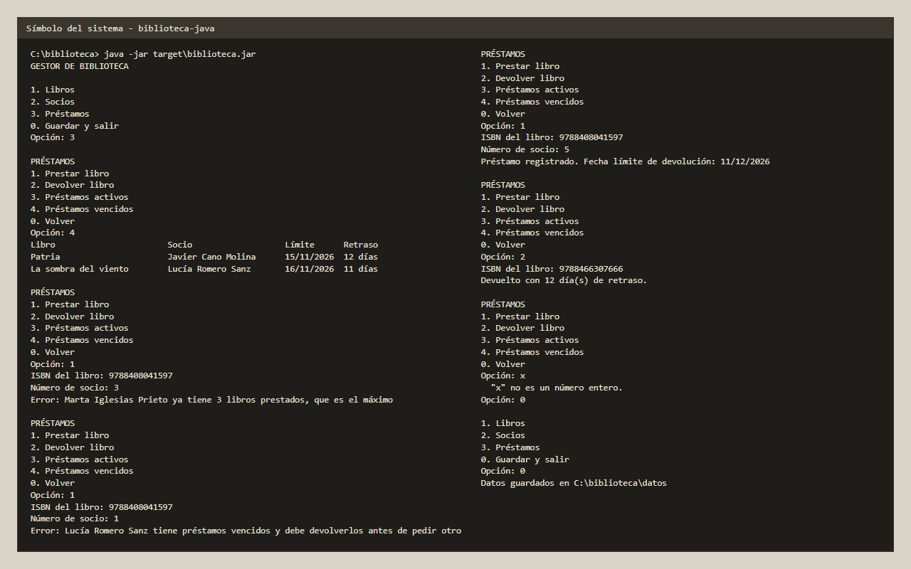

# Gestor de biblioteca

Aplicación de consola en Java para llevar una biblioteca pequeña: libros, socios y préstamos.
Controla que un socio no tenga más de 3 libros a la vez, que no se preste un libro que ya está fuera
y los préstamos que se pasan de los 14 días. Los datos se guardan en ficheros CSV dentro de `datos/`.



## Qué practico

Lo hice para los módulos de Programación y Entornos de desarrollo de DAW.

- Clases que validan sus datos en el constructor, un `enum` para los géneros y mis propias excepciones.
- `Map` y `List`, y streams para las búsquedas y los listados.
- Fechas con `LocalDate`: plazo de 14 días y días de retraso.
- Leer y escribir ficheros con `java.nio.file`.
- Maven, tests con JUnit 5 y sacar un `.jar` que se ejecuta solo.

## Tecnologías

Java 21, Maven 3.9 y JUnit 5. Se abre directamente como proyecto Maven en IntelliJ IDEA o en VS Code.

## Cómo ejecutarlo

Necesitas el JDK 21 y Maven en el PATH (en Windows, comprueba con `java -version` y `mvn -v`).

1. Abre una terminal en la carpeta del proyecto.
2. Pasa los tests:
   ```
   mvn test
   ```
3. Genera el jar (`mvn package` vuelve a pasar los tests):
   ```
   mvn package
   ```
4. Ejecuta el programa desde la carpeta del proyecto, para que encuentre `datos/`:
   ```
   java -jar target/biblioteca.jar
   ```
   También se le puede pasar otra carpeta de datos: `java -jar target/biblioteca.jar C:\otra\carpeta`.
   Si la carpeta no existe, arranca vacío y la crea al salir.

Los cambios se guardan al elegir la opción `0. Guardar y salir` del menú principal.
Si cierras la ventana o pulsas Ctrl+C sin pasar por la opción 0 se pierden los cambios de esa sesión.
Si editas los CSV a mano, guárdalos en UTF-8; si no, el programa avisa y no arranca.
Si en la consola de Windows salen mal las tildes, ejecuta antes `chcp 65001`.

## Estructura

```
biblioteca-java/
├── pom.xml
├── datos/                  libros.csv, socios.csv y prestamos.csv de ejemplo
├── docs/                   captura y el script que la genera
└── src/
    ├── main/java/es/michaelmarquez/biblioteca/
    │   ├── App.java            arranque: carga, menú y guardado
    │   ├── modelo/             Libro, Socio, Prestamo, Genero, Validacion
    │   ├── servicio/           Biblioteca (reglas) y excepciones
    │   ├── persistencia/       AlmacenCsv
    │   └── ui/                 MenuConsola y Entrada (lectura con Scanner)
    └── test/java/...           LibroTest, BibliotecaTest, AlmacenCsvTest
```

## Decisiones técnicas

Las reglas están en la clase `Biblioteca` y no en el menú, para poder probarlas con JUnit sin simular el teclado. Por lo mismo, los métodos que dependen del día reciben la fecha (`LocalDate hoy`) como parámetro en vez de llamar a `LocalDate.now()`: si no, no hay forma de probar un retraso de 5 días sin esperar 5 días.

- CSV separado por `;` y sin librerías. Los títulos llevan comas a menudo y el punto y coma casi nunca; además no lo dejo meter en los textos para que no se rompa ninguna línea.
- Si un fichero tiene una línea mal o los ficheros no cuadran entre sí (un préstamo de un socio que no existe, un ISBN repetido), el programa no arranca y dice qué pasa. Prefiero eso a cargar los datos a medias y que al salir se sobrescriba el fichero bueno.
- Los números de socio no se reutilizan: si se borra el último socio, el siguiente no hereda su historial de préstamos.
- Siempre leo con `nextLine()` y convierto yo el número, así una letra donde va un número no lanza `InputMismatchException` ni deja el `Scanner` atascado; se vuelve a preguntar.

Lo que no está: solo se guarda al salir, y los títulos con tilde al principio se ordenan mal ("Ébano" sale después de la Z).
